
<picture><source media="(max-width: 600px) and (prefers-color-scheme: dark)" srcset="assets/editorial/masthead-phone-dark.svg"><source media="(max-width: 600px)" srcset="assets/editorial/masthead-phone-light.svg"><source media="(prefers-color-scheme: dark)" srcset="assets/editorial/masthead-desk-dark.svg">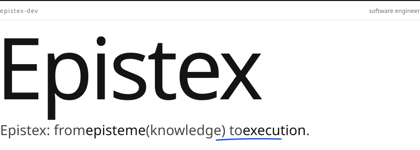</picture>

<picture><source media="(max-width: 600px) and (prefers-color-scheme: dark)" srcset="assets/editorial/about-phone-dark.svg"><source media="(max-width: 600px)" srcset="assets/editorial/about-phone-light.svg"><source media="(prefers-color-scheme: dark)" srcset="assets/editorial/about-desk-dark.svg">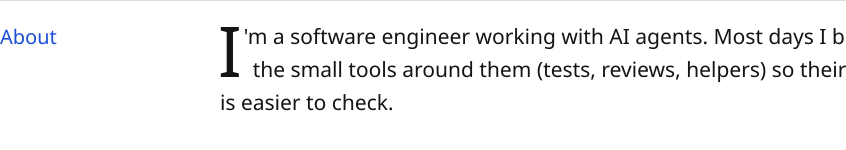</picture>

<picture><source media="(max-width: 600px) and (prefers-color-scheme: dark)" srcset="assets/editorial/focus-phone-dark.svg"><source media="(max-width: 600px)" srcset="assets/editorial/focus-phone-light.svg"><source media="(prefers-color-scheme: dark)" srcset="assets/editorial/focus-desk-dark.svg">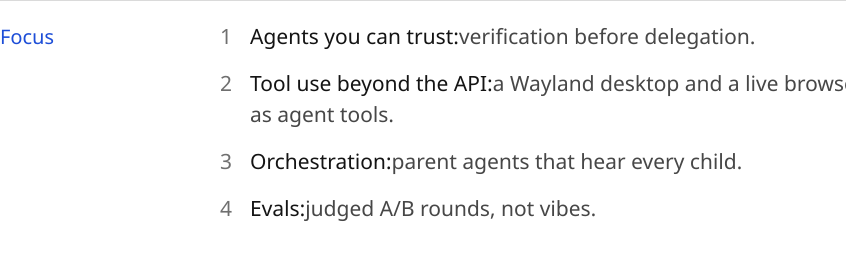</picture>

<picture><source media="(max-width: 600px) and (prefers-color-scheme: dark)" srcset="assets/agents/label-phone-dark.svg"><source media="(max-width: 600px)" srcset="assets/agents/label-phone-light.svg"><source media="(prefers-color-scheme: dark)" srcset="assets/agents/label-desk-dark.svg"></picture><picture><source media="(max-width: 600px) and (prefers-color-scheme: dark)" srcset="assets/agents/node-you-phone-dark.svg"><source media="(max-width: 600px)" srcset="assets/agents/node-you-phone-light.svg"></picture><picture><source media="(max-width: 600px) and (prefers-color-scheme: dark)" srcset="assets/agents/node-orchestrator-phone-dark.svg"><source media="(max-width: 600px)" srcset="assets/agents/node-orchestrator-phone-light.svg"></picture><picture><source media="(max-width: 600px) and (prefers-color-scheme: dark)" srcset="assets/agents/node-workers-phone-dark.svg"><source media="(max-width: 600px)" srcset="assets/agents/node-workers-phone-light.svg"></picture><picture><source media="(max-width: 600px) and (prefers-color-scheme: dark)" srcset="assets/agents/node-self-review-phone-dark.svg"><source media="(max-width: 600px)" srcset="assets/agents/node-self-review-phone-light.svg"></picture><picture><source media="(max-width: 600px) and (prefers-color-scheme: dark)" srcset="assets/agents/node-cross-model-review-phone-dark.svg"><source media="(max-width: 600px)" srcset="assets/agents/node-cross-model-review-phone-light.svg"></picture><picture><source media="(max-width: 600px) and (prefers-color-scheme: dark)" srcset="assets/agents/node-done-phone-dark.svg"><source media="(max-width: 600px)" srcset="assets/agents/node-done-phone-light.svg"></picture><picture><source media="(max-width: 600px)" srcset="assets/agents/empty-row.svg"><source media="(prefers-color-scheme: dark)" srcset="assets/agents/node-you-desk-dark.svg"></picture><picture><source media="(max-width: 600px)" srcset="assets/agents/empty-row.svg"><source media="(prefers-color-scheme: dark)" srcset="assets/agents/conn-1-desk-dark.svg"></picture><picture><source media="(max-width: 600px)" srcset="assets/agents/empty-row.svg"><source media="(prefers-color-scheme: dark)" srcset="assets/agents/node-orchestrator-desk-dark.svg"></picture><picture><source media="(max-width: 600px)" srcset="assets/agents/empty-row.svg"><source media="(prefers-color-scheme: dark)" srcset="assets/agents/conn-2-desk-dark.svg"></picture><picture><source media="(max-width: 600px)" srcset="assets/agents/empty-row.svg"><source media="(prefers-color-scheme: dark)" srcset="assets/agents/node-workers-desk-dark.svg"></picture><picture><source media="(max-width: 600px)" srcset="assets/agents/empty-row.svg"><source media="(prefers-color-scheme: dark)" srcset="assets/agents/conn-3-desk-dark.svg"></picture><picture><source media="(max-width: 600px)" srcset="assets/agents/empty-row.svg"><source media="(prefers-color-scheme: dark)" srcset="assets/agents/node-self-review-desk-dark.svg"></picture><picture><source media="(max-width: 600px)" srcset="assets/agents/empty-row.svg"><source media="(prefers-color-scheme: dark)" srcset="assets/agents/conn-4-desk-dark.svg"></picture><picture><source media="(max-width: 600px)" srcset="assets/agents/empty-row.svg"><source media="(prefers-color-scheme: dark)" srcset="assets/agents/node-cross-model-review-desk-dark.svg"></picture><picture><source media="(max-width: 600px)" srcset="assets/agents/empty-row.svg"><source media="(prefers-color-scheme: dark)" srcset="assets/agents/conn-5-desk-dark.svg"></picture><picture><source media="(max-width: 600px)" srcset="assets/agents/empty-row.svg"><source media="(prefers-color-scheme: dark)" srcset="assets/agents/node-done-desk-dark.svg"></picture>

<picture><source media="(max-width: 600px) and (prefers-color-scheme: dark)" srcset="assets/agents/you-sum-phone-dark.svg"><source media="(max-width: 600px)" srcset="assets/agents/you-sum-phone-light.svg"><source media="(prefers-color-scheme: dark)" srcset="assets/agents/you-sum-desk-dark.svg"></picture>

<picture><source media="(max-width: 600px) and (prefers-color-scheme: dark)" srcset="assets/agents/you-text-phone-dark.svg"><source media="(max-width: 600px)" srcset="assets/agents/you-text-phone-light.svg"><source media="(prefers-color-scheme: dark)" srcset="assets/agents/you-text-desk-dark.svg">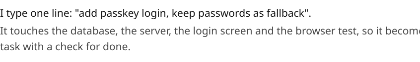</picture><picture><source media="(max-width: 600px) and (prefers-color-scheme: dark)" srcset="assets/agents/you-visual-phone-dark.svg"><source media="(max-width: 600px)" srcset="assets/agents/you-visual-phone-light.svg"><source media="(prefers-color-scheme: dark)" srcset="assets/agents/you-visual-desk-dark.svg"></picture>

<picture><source media="(max-width: 600px) and (prefers-color-scheme: dark)" srcset="assets/agents/orchestrator-sum-phone-dark.svg"><source media="(max-width: 600px)" srcset="assets/agents/orchestrator-sum-phone-light.svg"><source media="(prefers-color-scheme: dark)" srcset="assets/agents/orchestrator-sum-desk-dark.svg"></picture>

<picture><source media="(max-width: 600px) and (prefers-color-scheme: dark)" srcset="assets/agents/orchestrator-text-phone-dark.svg"><source media="(max-width: 600px)" srcset="assets/agents/orchestrator-text-phone-light.svg"><source media="(prefers-color-scheme: dark)" srcset="assets/agents/orchestrator-text-desk-dark.svg">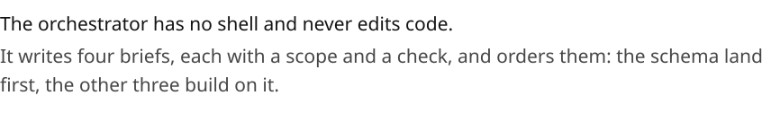</picture><picture><source media="(max-width: 600px) and (prefers-color-scheme: dark)" srcset="assets/agents/orchestrator-visual-phone-dark.svg"><source media="(max-width: 600px)" srcset="assets/agents/orchestrator-visual-phone-light.svg"><source media="(prefers-color-scheme: dark)" srcset="assets/agents/orchestrator-visual-desk-dark.svg"></picture>

<picture><source media="(max-width: 600px) and (prefers-color-scheme: dark)" srcset="assets/agents/workers-sum-phone-dark.svg"><source media="(max-width: 600px)" srcset="assets/agents/workers-sum-phone-light.svg"><source media="(prefers-color-scheme: dark)" srcset="assets/agents/workers-sum-desk-dark.svg"></picture>

<picture><source media="(max-width: 600px) and (prefers-color-scheme: dark)" srcset="assets/agents/workers-text-phone-dark.svg"><source media="(max-width: 600px)" srcset="assets/agents/workers-text-phone-light.svg"><source media="(prefers-color-scheme: dark)" srcset="assets/agents/workers-text-desk-dark.svg"></picture><picture><source media="(max-width: 600px) and (prefers-color-scheme: dark)" srcset="assets/agents/workers-visual-phone-dark.svg"><source media="(max-width: 600px)" srcset="assets/agents/workers-visual-phone-light.svg"><source media="(prefers-color-scheme: dark)" srcset="assets/agents/workers-visual-desk-dark.svg"></picture>

<picture><source media="(max-width: 600px) and (prefers-color-scheme: dark)" srcset="assets/agents/self-review-sum-phone-dark.svg"><source media="(max-width: 600px)" srcset="assets/agents/self-review-sum-phone-light.svg"><source media="(prefers-color-scheme: dark)" srcset="assets/agents/self-review-sum-desk-dark.svg"></picture>

<picture><source media="(max-width: 600px) and (prefers-color-scheme: dark)" srcset="assets/agents/self-review-text-phone-dark.svg"><source media="(max-width: 600px)" srcset="assets/agents/self-review-text-phone-light.svg"><source media="(prefers-color-scheme: dark)" srcset="assets/agents/self-review-text-desk-dark.svg"></picture><picture><source media="(max-width: 600px) and (prefers-color-scheme: dark)" srcset="assets/agents/self-review-visual-phone-dark.svg"><source media="(max-width: 600px)" srcset="assets/agents/self-review-visual-phone-light.svg"><source media="(prefers-color-scheme: dark)" srcset="assets/agents/self-review-visual-desk-dark.svg"></picture>

<picture><source media="(max-width: 600px) and (prefers-color-scheme: dark)" srcset="assets/agents/cross-model-review-sum-phone-dark.svg"><source media="(max-width: 600px)" srcset="assets/agents/cross-model-review-sum-phone-light.svg"><source media="(prefers-color-scheme: dark)" srcset="assets/agents/cross-model-review-sum-desk-dark.svg"></picture>

<picture><source media="(max-width: 600px) and (prefers-color-scheme: dark)" srcset="assets/agents/cross-model-review-text-phone-dark.svg"><source media="(max-width: 600px)" srcset="assets/agents/cross-model-review-text-phone-light.svg"><source media="(prefers-color-scheme: dark)" srcset="assets/agents/cross-model-review-text-desk-dark.svg">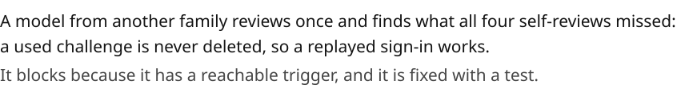</picture><picture><source media="(max-width: 600px) and (prefers-color-scheme: dark)" srcset="assets/agents/cross-model-review-visual-phone-dark.svg"><source media="(max-width: 600px)" srcset="assets/agents/cross-model-review-visual-phone-light.svg"><source media="(prefers-color-scheme: dark)" srcset="assets/agents/cross-model-review-visual-desk-dark.svg"></picture>

<picture><source media="(max-width: 600px) and (prefers-color-scheme: dark)" srcset="assets/agents/done-sum-phone-dark.svg"><source media="(max-width: 600px)" srcset="assets/agents/done-sum-phone-light.svg"><source media="(prefers-color-scheme: dark)" srcset="assets/agents/done-sum-desk-dark.svg"></picture>

<picture><source media="(max-width: 600px) and (prefers-color-scheme: dark)" srcset="assets/agents/done-text-phone-dark.svg"><source media="(max-width: 600px)" srcset="assets/agents/done-text-phone-light.svg"><source media="(prefers-color-scheme: dark)" srcset="assets/agents/done-text-desk-dark.svg"></picture><picture><source media="(max-width: 600px) and (prefers-color-scheme: dark)" srcset="assets/agents/done-visual-phone-dark.svg"><source media="(max-width: 600px)" srcset="assets/agents/done-visual-phone-light.svg"><source media="(prefers-color-scheme: dark)" srcset="assets/agents/done-visual-desk-dark.svg"></picture>

<picture><source media="(max-width: 600px) and (prefers-color-scheme: dark)" srcset="assets/editorial/setup-phone-dark.svg"><source media="(max-width: 600px)" srcset="assets/editorial/setup-phone-light.svg"><source media="(prefers-color-scheme: dark)" srcset="assets/editorial/setup-desk-dark.svg">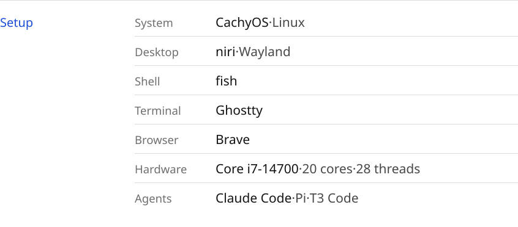</picture>

<picture><source media="(max-width: 600px) and (prefers-color-scheme: dark)" srcset="assets/editorial/principles-phone-dark.svg"><source media="(max-width: 600px)" srcset="assets/editorial/principles-phone-light.svg"><source media="(prefers-color-scheme: dark)" srcset="assets/editorial/principles-desk-dark.svg">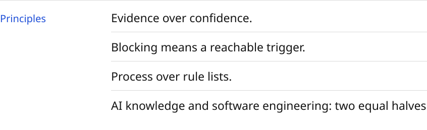</picture>

<picture><source media="(max-width: 600px) and (prefers-color-scheme: dark)" srcset="assets/editorial/run-phone-dark.svg"><source media="(max-width: 600px)" srcset="assets/editorial/run-phone-light.svg"><source media="(prefers-color-scheme: dark)" srcset="assets/editorial/run-desk-dark.svg"></picture>

<picture><source media="(max-width: 600px) and (prefers-color-scheme: dark)" srcset="assets/editorial/colophon-phone-dark.svg"><source media="(max-width: 600px)" srcset="assets/editorial/colophon-phone-light.svg"><source media="(prefers-color-scheme: dark)" srcset="assets/editorial/colophon-desk-dark.svg"></picture><a href="mailto:epistex.dev@gmail.com"><picture><source media="(prefers-color-scheme: dark)" srcset="assets/editorial/say-hi-all-dark.svg"></picture></a>

